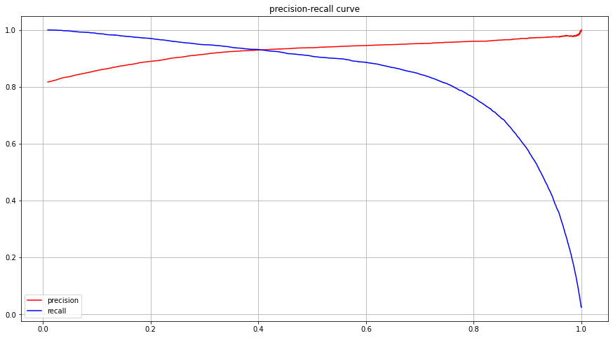
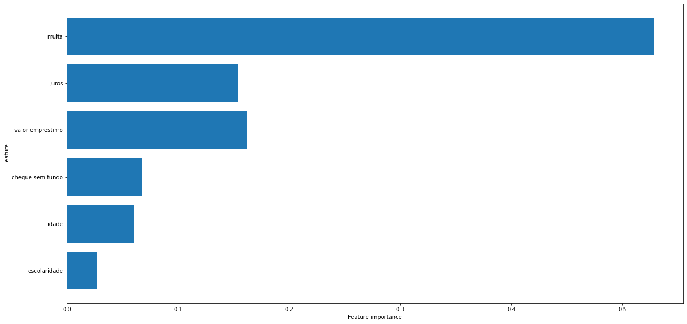

# Loan default: from raw data to a tuned classifier

Which borrowers won't pay back? This project takes 50,390 loans with 23 raw fields, cleans
them, works out which attributes actually relate to default, and trains a Random Forest
that flags defaulters with a tunable decision threshold.

**[Read the notebook on nbviewer](https://nbviewer.org/github/jvitorcosta/loan-EDA-python/blob/main/loan_case.ipynb)**
(no Jupyter needed). The notebook and its comments are in Portuguese; this page summarises
it in English.

  

## Results

Test set: 7,945 loans (30% stratified hold-out). 18% of loans default, so accuracy alone
says little; the numbers that matter are for the **default** class.

| Model | Default recall | Default precision | Paid F1 |
|-------|---------------:|------------------:|--------:|
| Random Forest baseline | 0.57 | 0.74 | 0.93 |
| Tuned (RandomizedSearchCV, 10-fold, `class_weight="balanced"`) | **0.73** | 0.64 | 0.92 |

- Tuning catches **16 points more defaulters** (recall 0.57 → 0.73) at the cost of more
  false alarms. For a lender that trade is usually worth it: a missed default costs the
  loan, a false alarm costs a manual review.
- The threshold is a business decision, not a constant. Moving it from 0.5 to 0.785
  raises the precision of "will pay" predictions from 0.937 to 0.959, so fewer bad loans
  get approved. The chart above is what you'd hand a credit team to pick their point.

## How it was done

1. **Data understanding.** Every field documented and the dataset made consistent (types,
   column names, encodings).
2. **Missing values.** Education is missing for 71% of rows and informal income for 81%.
   Missing education became its own "not informed" category instead of dropping rows.
3. **Categorical variables.** State, education, marital status, gender and account types
   checked for imbalance and default rate, and for which could be dropped to simplify the
   model or avoid regional bias.
4. **Continuous variables.** Income, age, fees, interest and loan amount: boxplots, skew
   and outliers. Outliers were kept, since in credit the extreme borrowers are often the
   informative ones.
5. **Model.** Random Forest baseline, then a 200-fit randomized search, then threshold
   tuning on the precision-recall curve.

## What I'd change today

- **Check `multa` (late fee) for leakage.** It carries over half the model's importance. If
  the fee is charged *after* a missed payment, it's only known once default has started,
  and the real-world model would be much weaker. I'd confirm when the field is filled in
  and retrain without it.
- **Compare against gradient boosting** (LightGBM) and a logistic-regression scorecard,
  which credit teams can audit line by line.
- **Report PR-AUC for the default class** and a cost-weighted metric, and explain
  individual decisions with SHAP.

 

## Files

- `loan_case.ipynb`: the analysis and model
- `loan_case.html`: the same notebook, rendered
- `dados.xls`, `descricao_dados.xlsx`: the data and its field descriptions
- `docs/images/`: charts exported from the notebook

**Stack:** Python, pandas, scikit-learn, Matplotlib, Seaborn, Jupyter
